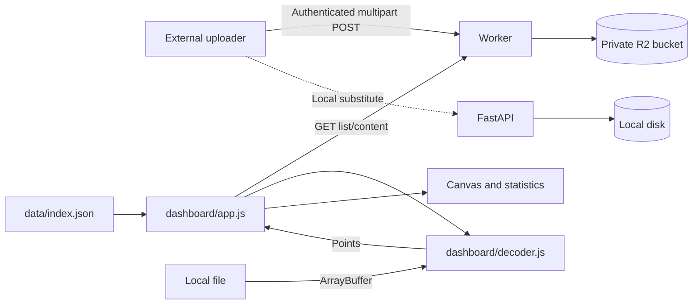

# Marine Motion Logger — Developer Manual

This manual covers the current static viewer, Worker/R2 service, local FastAPI upload substitute and scripts. Firmware acquisition, SD logging, Wi-Fi control and on-device upload scheduling are outside this checkout. Their implementation cannot be inferred from this service.

User workflows belong in the [User Manual](README.md). Byte layouts belong in the [format reference](docs/dashboard-data-format.md). See also [browser verification](docs/viewer-development.md) and [upload verification](docs/first-upload-verification.md).

## Contents

- [Architecture](#architecture)
- [Development setup](#development-setup)
- [Configuration](#configuration)
- [API contracts](#api-contracts)
- [Viewer implementation](#viewer-implementation)
- [Modify and extend](#modify-and-extend)
- [Debugging and validation](#debugging-and-validation)
- [Documentation maintenance](#documentation-maintenance)

## Recording contract

External firmware records 100 Hz RAW to SD only. SUMMARY v3 aggregates all samples actually collected in each completed approximately one-second monotonic window, normally about 100 but not a fixed count. Empty intervals are omitted; Stop discards unfinished final intervals. SUMMARY remains on SD and is uploadable over HTTPS. V3 retains the 75-byte header and 90-byte records but changes the version and field semantics: uint16 summary_hz=1 at offset 14 and uint8 time_basis=1 at offset 70. These offsets were verified against Motion Logger DATA_FORMAT.md sections 6.4-6.8 and RecordFormats.h in the sibling firmware project. V1/v2 decoding and existing backend upload compatibility are retained; the current firmware selects only v3 for upload. No rate is inferred for legacy local files.

## Architecture



| Source | Responsibility |
|---|---|
| `dashboard/index.html` | Controls and disclosures; loads decoder before app |
| `dashboard/style.css` | Responsive layout and theme variables |
| `dashboard/decoder.js` | Shared browser/Worker binary validation, conversion, timestamp checks, CRC32, sampling and full-record CSV export |
| `dashboard/app.js` | Loading, normalization, state, chart, interaction and statistics |
| `backend/worker/index.js` | SUMMARY validation, independent CRC32, snapshot identity, R2 metadata/storage and read CORS |
| `backend/app/main.py` | Local filesystem upload substitute and health endpoint |
| `wrangler.jsonc` | Worker entry point and R2 binding |
| `.github/workflows/pages.yml` | Static staging and Pages deployment |
| `scripts/test_viewer.cjs` | Node VM harness with generated binary fixtures, including 1/10 Hz SUMMARY |
| `scripts/test_summary_workflow.cjs` | SUMMARY upload/read regression checks with in-memory R2 |
| `scripts/test_local_summary.py` | FastAPI SUMMARY checks with temporary storage |

R2 is private, but Worker read endpoints require no authentication. CORS restricts browser origins, not other clients. No upload key belongs in frontend code. Uploads do not write measurement files or index entries to GitHub.

## Development setup

### Viewer

Use the User Manual's static-server command. There are no frontend runtime packages or build step. Node runs the VM checks; Python runs the local server and FastAPI.

For testing index resolution, stage the same layout as Pages:

```powershell
New-Item -ItemType Directory -Force .preview/data
Copy-Item dashboard/index.html,dashboard/app.js,dashboard/decoder.js,dashboard/style.css .preview
Copy-Item data/index.json .preview/data
python -m http.server 8000 --directory .preview
```

Remove the generated `.preview` directory after testing; do not commit it. Serving the repository root and visiting `/dashboard/` requests `/dashboard/data/index.json`, which does not exist. `INDEX_URL` resolves against `document.baseURI`.

### Local upload substitute

Python 3.10+ is required by the source syntax. From the repository root:

```powershell
python -m venv .venv
.\.venv\Scripts\Activate.ps1
python -m pip install -r backend/requirements.txt
$env:DEVICE_API_KEY = 'dev-test-key'
uvicorn app.main:app --app-dir backend --host 127.0.0.1 --port 8787
```

Use port 8000 for the viewer. FastAPI has no cloud list/content routes or viewer CORS. Environment variables are read at import; restart after changes.

### Worker

```powershell
npm ci
npm run worker:dev
```

For local uploads, create root `.dev.vars` containing `DEVICE_API_KEY="dev-test-key"`. This file is ignored by Git. Wrangler's local storage is separate from production R2.

For the intended Cloudflare account and an existing target bucket, these commands set the remote secret and publish the Worker:

```powershell
npx wrangler secret put DEVICE_API_KEY
npm run worker:deploy
```

Use HTTPS for production uploads. Worker deployment is separate from Pages deployment.

## Configuration

| Setting | Current location/value | Effect |
|---|---|---|
| `WORKER_URL` | `app.js`: `https://marine-motion-storage-api.stavanger.workers.dev` | Cloud API target; edit source to change |
| `INDEX_URL` | `app.js`: `data/index.json` relative to document | Published library metadata |
| `REPO_RAW` | `app.js`: `https://raw.githubusercontent.com/hui-aqua/Storage/main/` | Base for published CSV `path` |
| `MAX_PLOT_POINTS` | `decoder.js`: 12000 | Binary plot retention ceiling; export bypasses it |
| `MAX_FILE_BYTES` | Both backends: 10 × 1024 × 1024 | Upload size limit; update both implementations together |
| `DEVICE_API_KEY` | Worker secret; FastAPI environment with default `dev-test-key` | Exact Bearer credential; Worker has no default |
| `DATA_DIR` | FastAPI environment, default `data/uploads` | Relative to process working directory unless absolute |
| `UPLOADS` | Wrangler R2 binding, bucket `marine-motion-uploads` | Worker persistence |
| `READ_DEVICES` | Worker: CS01-CS04 and CS3_01-CS3_04 | Read allowlist; also encoded in key regex and HTML options |
| `ALLOWED_ORIGINS` | Worker | `https://hui-aqua.github.io`, `http://localhost:8000`, `http://127.0.0.1:8000` |
| Deployment | `wrangler.jsonc` | Name `marine-motion-storage-api`; entry `backend/worker/index.js`; compatibility date `2026-11-10` |
| Theme | Browser local storage `motion-theme` | light/dark/system; default light |

Changing hostnames or local viewer ports requires reviewing CORS. These frontend constants are not environment variables.

## API contracts

### SUMMARY upload

Both backends accept authenticated multipart POST /api/v1/upload with Authorization: Bearer <DEVICE_API_KEY>. The production Worker stores in R2; FastAPI is a local substitute with metadata JSON sidecars.

| Field | Validation |
|---|---|
| file | Complete aligned SUMMARY binary, <=10 MiB; .bin suffix is case insensitive |
| device_id | CS01-CS04 or CS3_01-CS3_04; must match header device |
| timestamp | ISO-8601 with timezone; converted to UTC |
| date | YYYY-MM-DD equal to timestamp's UTC date; today/partial-day accepted |
| summary_hz | V3: 1, agreeing with header; legacy: 1 or 10 as explicit metadata |
| sampling_frequency | Firmware-compatible alias for summary_hz; if both provided they must agree |
| measurement_type | motion_summary |
| file_format | cs3_summary_v1, cs3_summary_v2 or cs3_summary_v3, matching actual header version |
| crc32 | Eight hex digits, no prefix; checked against independently computed whole-file CRC |
| size_bytes | Decimal whole-file byte count, verified against uploaded file |

RAW magic is rejected. V3 requires summary_hz=1 and header time_basis=1 plus at least one complete record. Upload metadata must agree with the header. Header-only files remain locally decodable for every version; legacy header-only upload behavior is retained, while v3 header-only uploads return 422. Partial tails are rejected for upload but reported/displayed locally. A partial-day file containing one or more completed windows is valid; no full-day record count is required. Version is never inferred from size, suffix or content cadence.

The legacy acceleration/binary upload route with sampling_frequency=50 retains filename/SHA-256 behavior for existing clients. Current SUMMARY uploads use the snapshot contract above.

CRC is CRC-32/ISO-HDLC (IEEE): reflected polynomial 0xedb88320, initial/final XOR 0xffffffff, over every file byte including header. Python zlib.crc32 produces the same value. SHA-256 is independently retained for content-integrity collision checks. CRC32 is not cryptographic authentication.

Snapshot key: device_id/YYYY/MM/DD/<eight-digit-crc32>.bin. The original filename is metadata, not identity. Same device/date/CRC and matching SHA/size returns ALREADY_EXISTS without a write; changed content/CRC returns STORED under a different key, even for the same date/filename. A CRC collision with different SHA/size returns 409 and preserves existing content. The get-then-put sequence is not an exactly-once concurrency guarantee.

Both success responses include status/result (STORED or ALREADY_EXISTS), device_id, date, filename, size_bytes, crc32, sha256, summary_hz, record_count, storage=r2 and path. FastAPI uses storage=local-test. Successful duplicates retain stored metadata and bytes. R2 custom metadata stores SHA, CRC, device/date/timestamp, summary_hz, sampling_frequency, measurement_type, file_format, original_filename, size_bytes, record_count, represented_duration_seconds, firmware, created_utc, format_version, timestamp_semantics and (v3) time_basis. No index/CSV publication is performed.

Errors: 401 credential; 422 metadata, CRC, size mismatch, invalid binary or RAW; 413 file size; 409 CRC collision; Worker 400 malformed multipart and 503 missing binding. Worker checks announced request size against 10 MiB + 64 KiB before multipart parsing, then actual file size. FastAPI reads at most the file limit plus one byte.

### Worker reads and snapshot selection

| Route | Behavior |
|---|---|
| GET /health | Status ok; no storage probe |
| GET /api/v1/files?device=CS3_03 | All versions, including previous same-day snapshots and legacy keys |
| GET /api/v1/files/content?key=... | Streams original bytes as attachment, private/no-store |
| OPTIONS on read routes | Read CORS response |

R2 lists request customMetadata with pagination (1000/page). List entries include key, device_id, date, filename, size_bytes, uploaded, metadata fields and preferred. summary_hz and record_count are numeric or null for legacy objects. When summary_hz is absent, sampling_frequency is accepted as a metadata alias only on explicitly typed motion_summary objects and only for 1 or 10; legacy acceleration metadata is never treated as SUMMARY frequency. Ordering is descending date, descending file size, newest upload on ties, then key. One preferred entry per date is marked; the viewer independently applies the same order and selects the first entry. All earlier snapshots remain accessible. Largest file is a completeness heuristic, not a guarantee after resets or mixed historical formats/rates.

Read paths require an allowed device, valid calendar date and safe lowercase .bin filename. Historical filename-based keys are retained and remain readable. Objects without summary_hz are not retroactively labeled 10 Hz. Read endpoints remain unauthenticated; CORS is not access control.

## Viewer implementation

### Display timezone

`dashboard/app.js` detects Browser Local using `Intl.DateTimeFormat().resolvedOptions().timeZone`. The `#timezone` selector defaults to Browser Local and also offers `Europe/Oslo` and `UTC`. Add an option whose value is an IANA timezone identifier to extend the list, for example `Asia/Shanghai`.

`displayParts()` caches `Intl.DateTimeFormat` instances per zone. `displayTimestamp()`, `axisLabel()` and `timeLabel()` format UTC instants only at rendering time. Intl determines date-specific DST automatically. `updateTimeZoneLabel()` shows the selected zone and visible endpoint abbreviations/offsets, including both when they differ. Tooltips always include a separate UTC endpoint. V3 local interval bounds are formatted independently across DST changes.

The selector calls `update()` without loading or adopting data. UTC chart coordinates, range calculations, hover lookup, normalized points and source buffers retain their values. Local and remote binary paths share these formatters after `adopt()`. Relative, sensor, monotonic and record-order clocks keep their existing labels. SUMMARY layout, decoder, upload API, storage and CSV export require no timezone conversion.

### Binary decoder

`decoder.js` exposes `window.decodeBinary(buffer, options = {})` and `window.binaryCsv(buffer, options = {})` and `globalThis.motionCrc32(buffer)`:

```javascript
const result = window.decodeBinary(buffer); // v3 rate/time basis come from header
// For legacy cloud files only, pass known rate via { summaryHz: 10 }.
// V3 rejects metadata that conflicts with the header.
console.log(result.header, result.recordCount, result.tailBytes);
const complete = window.decodeBinary(buffer, { allRecords: true });
const csv = window.binaryCsv(buffer);
```

The result includes `status`, `decoded`, `kind`, `header`, `recordCount`, `plottedCount`, `stride`, `tailBytes`, `damaged`, `points`, `representedDurationSeconds`, `timestampSpanSeconds`, `timestampsValid`, `monotonicValid`, `monotonicSpanSeconds`, `windowCoverageSeconds`, `message`. Invalid headers throw. Valid headers with zero records are accepted. Incomplete trailing records are excluded and reported.

Default stride is `max(1, ceil(fullRecords / 12000))`; retained indices are 0, stride, 2×stride, etc. This is regular sampling, not averaging or peak preservation; the final original record may be omitted. Zoom does not re-decode. uint64 timestamps remain decimal strings in points; the chart converts them to Numbers and can lose precision for large values.

`binaryCsv(buffer, {summaryHz})` uses `allRecords: true` and preserves supplied rate metadata in exported header columns. Columns contain prefixed header metadata (`header_...`), `record_index`, then point fields. Every value is quoted; null becomes empty. RAW retains integer counts alongside engineering values. Export materializes all points and CSV in memory and may be expensive. Its schema differs from daily SUMMARY CSV input.

### Loading, state and rendering

`openLocal()` reads `.csv` as text and other files as ArrayBuffer. `loadCloudFile()` fetches binary; `selectRecord()` calls `loadSummary()` for published CSV. Increasing `loadToken` prevents an older load from replacing a newer selection.

`adopt()` calls `normalize()`, resets the viewport, updates metadata and disables unavailable signals. Binary battery volts become mV. State contains normalized retained points, source records, series, axes, fractional viewport and chart times; exportSource retains the full binary/text. Cloud loading passes explicit listing rate and verifies CRC before adopting bytes. Local v3 obtains its rate from the header; local v1/v2 remain unknown. File information exposes header version, time_basis, rate/source and timestamp semantics. Timestamp span is last minus first endpoint; v3 completed-window total is record count / 1 Hz, while windowCoverageSeconds is last end minus first end plus one second, including omitted intervals. Coverage uses a valid monotonic clock first, otherwise valid UTC, and is null if neither clock is reliable. No synthetic samples are introduced.

RAW charts use sensor time. Legacy SUMMARY uses emission UTC when valid and nondecreasing, otherwise metadata-based nominal relative time or record order. V3 UTC and sensor_time_us are exclusive completed-window ends; the latter is a host monotonic clock, not the old mixed sensor/poll clock. The decoder validates every original timestamp, including records omitted from plotting. With invalid/decreasing UTC, v3 uses recorded strictly increasing host monotonic ends (preserving real gaps); if that clock resets too, it uses record order. V3 never synthesizes elapsed time from index/Hz. Header time_valid does not override per-record validity. The same field at offset 8 in a record must therefore be interpreted by version.

`bounds()` maps viewport fractions to retained indices; `setRange()` clamps range and minimum span. `drawChart()` uses timestamp spacing, adaptive `timeTicks()`, device-pixel-ratio sizing, visible-range vertical autoscaling and gaps at nonfinite values. Hover binary-searches the nearest retained timestamp.

`signals`, `entries()` and `value()` select fields and derive vector magnitude. V3 decoded points also expose paired-sample validity, loss, timingWarning (bit 6), emptyIntervalGap (bit 7), explicit UTC/monotonic window bounds and gapBefore. Gaps or session discontinuities break rendered lines; a prefix count propagates gaps across plot subsampling. Hover labels show half-open intervals and quality flags. `statistics()` computes unweighted mean, RMS, min, max and absolute peak over finite values in the visible retained range, not time-weighted integrals. `applyTheme()` combines selection and OS preference; canvas colors come from CSS variables.

Local original-download blob URLs are revoked on replacement. Cloud originals use a fresh service request. Export dispatches a temporary CSV blob download and revokes its URL afterward.

### Published index and CSV defect

`data/index.json` currently has `schema_version: 1` and an empty `records` array. `init()` checks only that records is an array and sorts descending timestamp; it does not validate schema_version.

| Entry fields | Use |
|---|---|
| `device_id`, `timestamp`, `filename`, `size_bytes`, `sha256` | Labels, sorting, search and history |
| `url` or `path` | CSV source; url wins, otherwise path resolves against REPO_RAW |
| `raw_key`, `raw_filename` | Optional associated RAW link via Worker |

Illustrative entry; no matching measurement is supplied:

```json
{
  "device_id": "CS01",
  "timestamp": "2026-11-10T08:00:00Z",
  "filename": "summary.csv",
  "path": "data/summaries/summary.csv",
  "size_bytes": 1234,
  "raw_key": "CS01/2026/11/10/recording.bin",
  "raw_filename": "recording.bin"
}
```

No backend generates CSV or updates this index. Pages copies only viewer assets and index; referenced CSVs must be available separately through their source URLs.

**Known defect:** `parseCsv()` references `SUMMARY_COLUMNS`, which is not defined anywhere in this checkout. CSV input with at least two lines fails. The parser also splits on commas/newlines without quoted-field support, filters only on finite motion axes, and `normalize()` converts empty ancillary fields to zero through `Number()`. Before claiming CSV support, define/test a canonical column contract and missing-value rules. The quoted decoder export is a different schema and is not round-trip viewer input.

## Modify and extend

### Add a display signal

1. Identify an actual decoded field; add versioned decoding only from a concrete format specification.
2. Preserve missing values and choose units in `normalize()`.
3. Add a `signals` entry and matching `#signal` option in HTML.
4. Verify availability, labels, statistics and present/absent values with a fixture.

For example, RAW already exposes boolean `loss`. These additions would expose it as a new channel (not currently installed):

```javascript
// Add to signals:
loss: { label: 'Loss detected', unit: '0 / 1', keys: ['loss'] }
```

```html
<!-- Add inside #signal: -->
<option value="loss">Loss detected</option>
```

Existing `value()` converts booleans to 0/1 and availability detection accepts booleans.

### Formats, devices and analysis

For a binary version, update `parseHeader()` validation and record decoding together. Never silently reinterpret an existing version. Add fixtures covering scaling, invalid headers, sentinels and tails; update the format reference.

Worker imports the shared decoder as a side-effect module; keep it browser/Worker compatible (no DOM access during initialization). V3 branches explicitly on format_version=3, validates summary_hz/time_basis and preserves legacy reserved-byte interpretation. RAW version 3 remains unsupported.

For a device, update Worker `READ_DEVICES`, `validR2Key()` and HTML selector together. For upload metadata or limits, update both backends and verify external uploader compatibility. The SUMMARY upload path validates binary structure using the shared decoder. V3 nominal rate is embedded at offset 14; legacy nominal rate remains external metadata. Metadata/header disagreement is a validation error.

Full-bandwidth analysis needs all records or a separate streaming path. Retained plot points are unsuitable for original-sample FFT/PSD or guaranteed peak detection.

### Pages deployment

The workflow runs manually or on main pushes affecting `dashboard/**`, `data/index.json` or the workflow itself. Documentation-only pushes do not deploy. Four frontend files are staged at site root and index under `data/`, then published through Pages Actions.

## Debugging and validation

```powershell
node scripts/test_viewer.cjs
node scripts/test_summary_workflow.cjs
npm run worker:build # local bundle only; no deployment
.\.venv\Scripts\python.exe scripts/test_local_summary.py
node --check dashboard/app.js
node --check dashboard/decoder.js
```

The harness covers RAW v1/v2 and SUMMARY v1/v2/v3, scaling, local open/drop, download links, battery conversion, axes, range interactions, themes, statistics, cloud failure isolation, full-record export, ticks and duration. It uses stubbed DOM/canvas/network surfaces. It does not verify browser layout, native dialogs, completed downloads or successful CSV parsing. The separate Worker harness runs real request/response handlers against a paginated in-memory R2 double; the Python test exercises FastAPI handlers and temporary disk storage. Neither establishes live Cloudflare deployment or native browser acceptance.

An optional SUMMARY check runs if the default field file exists, or accepts an explicit path:

```powershell
node scripts/test_viewer.cjs path/to/example.bin
```

The supplied file must be compatible SUMMARY without a partial tail. Private data is not required in a checkout. Follow the linked browser and upload verification guides for integration checks.

| Failure | Investigation |
|---|---|
| Binary rejected | Header magic/version/sizes, RAW ranges/rate, decoder error |
| CSV fails | Missing SUMMARY_COLUMNS contract described above |
| Cloud fails locally | Worker URL, browser Network panel, origin/CORS; FastAPI has no read routes |
| Upload absent from list | Strict read key rules versus broader legacy upload rules |
| 401 / 409 / 413 | Credential / same key with different digest / size limit |
| Index 404 | Staging layout and document-relative INDEX_URL |
| Unexpected statistics | Stride, retained bounds, validity and units |
| Time fallback | Per-record times and flags; do not infer RAW UTC from creation time |

## Documentation maintenance

Keep user actions in README, architecture/configuration here, byte offsets in the format reference and acceptance procedures in focused guides. Update relevant documents and links with behavior changes. Review both upload implementations, decoder, UI and Pages staging rather than copying firmware assumptions.

Use repository-relative links and check them after moves. Do not present one-off field measurements as universal rate guarantees.
